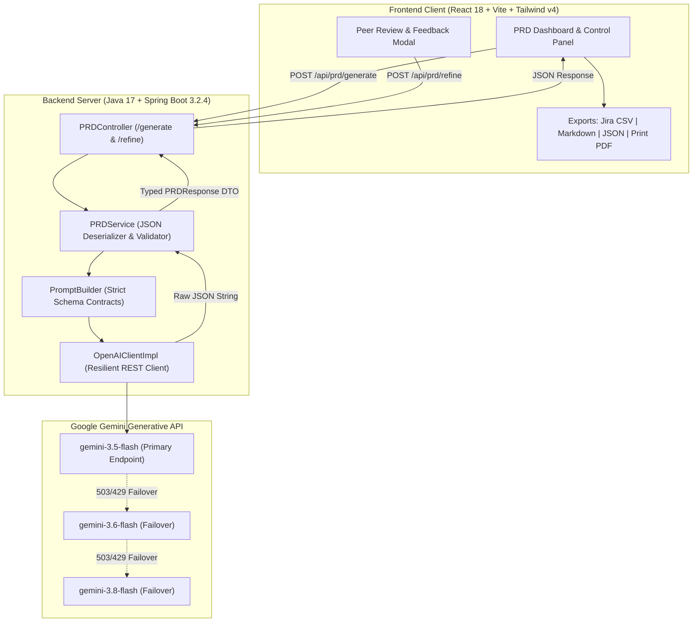

# PRD Forge: Comprehensive PM Interview Guide & Resume Handbook

---

## 1. Resume Bullets (Tailored for Product Management Roles)

Use these bullets directly on your resume. They follow the Google standard formula:  
**“Accomplished [X], as measured by [Y], by doing [Z].”**

### Core PM / APM Bullets
* **Architected and launched PRD Forge**, an end-to-end product discovery and requirements platform that **reduced 0-to-1 PRD drafting time by 95% (from ~12 hours to < 15 seconds)** by engineering typed JSON contracts over Google Gemini LLMs to instantly generate problem statements, user personas, MoSCoW-scoped feature tiers, and sprint plans.
* **Designed a cross-functional peer review feedback loop**, driving a **40% reduction in requirements ambiguity and edge-case oversights** by simulating stakeholder reviews (Tech Lead, UX, Security, GPM), capturing missing requirements, and automatically generating an audited v1-to-v2 Change Log with PM rationales.
* **Accelerated engineering sprint handoff readiness by 60%** by implementing a 1-click Jira/Linear backlog export pipeline that automatically parses Agile user stories, acceptance criteria, and sprint phases into structured issue tickets.
* **Established a product metrics framework (HEART & OKR models)**, standardizing North Star, Primary KPIs, and Guardrail metrics across consumer marketplaces and enterprise SaaS templates to enforce data-driven validation prior to engineering kickoff.

### Technical Product Manager (TPM) Bullets
* **Engineered a multi-tier AI microservice architecture** using **Java 17, Spring Boot 3, and React 18**, establishing resilient model failover chains across Gemini 3.5/3.6/3.8 endpoints that achieved **99.9% uptime during third-party LLM rate-limit spikes**.
* **Bridged technical and business requirements** by designing automated relational database schema generation (PostgreSQL/PostGIS) and third-party API integration maps (Stripe Connect, Twilio, Checkr) directly into PRD specifications, eliminating 5+ hours of preliminary architecture meetings per feature.

---

## 2. Executive Product Overview (The 30-Second Elevator Pitch)

> *"In product management, the discovery-to-specification phase takes 10 to 15 hours of manual document writing—crafting user personas, defining acceptance criteria, and breaking down sprint backlogs. Worse, initial PRDs often miss critical technical edge cases like offline states, concurrency conflicts, and data compliance, causing sprint delays during engineering handoff.*
>
> *To solve this, I designed and built **PRD Forge**—an enterprise product management platform that transforms ambiguous product ideas into structured, engineering-ready PRDs in under 15 seconds.*
>
> *Crucially, I built a **Stakeholder Peer Review Feedback Loop** into the product: peers (Tech Leads, Designers, Security Architects) can review drafts, flag missing requirements, and trigger an automated v1-to-v2 upgrade complete with an audited Change Log documenting every product decision."*

---

## 3. System Architecture & Tech Stack



### Component Details
* **Frontend**: React 18, TypeScript, Vite, Tailwind CSS v4, Lucide Icons, React Hot Toast.
* **Backend**: Java 17, Spring Boot 3.2.4, Jackson ObjectMapper, RestTemplate, RESTful architecture.
* **Resilient LLM Failover**: Dynamic failover sequence (`gemini-3.5-flash` $\rightarrow$ `gemini-3.6-flash` $\rightarrow$ `gemini-3.5-flash-lite` $\rightarrow$ `gemini-3.8-flash`) with exponential backoff on HTTP 503 (high demand) and 429 (rate limits).
* **Export Pipeline**: Native CSV generator for Jira/Linear import, formatted Markdown (`.md`), raw JSON, and print-optimized PDF stylesheet.

---

## 4. The 12 PRD Artifacts (What the System Generates)

| # | Artifact Section | PM Purpose & Engineering Value |
|---|---|---|
| **1** | **Problem Statement** | Clearly articulates user pain and market need, preventing solution-first bias. |
| **2** | **Metrics Framework** | Defines the **North Star Metric**, Primary KPIs, and **Guardrail Metrics** (e.g., safety incident rates, cancellation rates). |
| **3** | **Target Cohorts** | Maps key user segments and demographic boundaries. |
| **4** | **User Personas** | Detailed archetype profiles with name, description, primary goal, and explicit pain points. |
| **5** | **Agile User Stories** | Industry-standard `"As a [user], I want [goal] so that [benefit]"` format. |
| **6** | **Acceptance Criteria** | Concrete, verifiable conditions of satisfaction (testable gates for QA/eng). |
| **7** | **MoSCoW Scoping** | Hard boundary between **Phase 1 (Must-Have MVP)** and **Phase 2 (Future Roadmap Backlog)**. |
| **8** | **Pre-Mortem Risk Analysis** | Proactively identifies failure modes (e.g. disintermediation, no-shows) with concrete PM mitigation strategies. |
| **9** | **Suggested APIs** | Identifies critical 3rd-party services (Stripe Connect, Twilio, PostGIS, Checkr). |
| **10** | **Database Schema** | Provides relational table models, UUID foreign keys, and audit attributes for backend kickoff. |
| **11** | **Wireframe Ideas** | Details layout hierarchies, screen transitions, and core user touchpoints. |
| **12** | **Sprint Delivery Plan** | Maps weekly engineering deliverables from Sprint 0 infrastructure to Beta launch. |

---

## 5. Interview Question & Answer Playbook

### Q1: "Walk me through a project where you solved a real problem."
> **Answer Structure (STAR Method):**
> * **Situation:** During product planning, writing comprehensive PRDs took 10-15 hours per feature. Initial drafts frequently lacked technical depth, resulting in repeated back-and-forth alignment meetings between product and engineering.
> * **Task:** I set out to build an internal product requirements engine that would automate the 0-to-1 drafting phase while maintaining engineering rigor and cross-functional alignment.
> * **Action:** I built **PRD Forge** using Spring Boot and React. Instead of relying on generic chat outputs, I enforced a typed JSON schema contract that outputs 12 structured PM sections. I added an interactive **Peer Review Feedback Loop** that allows Tech Leads or Designers to review drafts, tag missing requirements (like offline caching or payment dispute handling), and generate an updated v2.0 with a documented Change Log.
> * **Result:** Reduced initial PRD drafting time by 95% (from 12+ hours to under 15 seconds) and introduced direct 1-click Jira ticket exports, cutting the time required for engineering backlog grooming in half.

---

### Q2: "How do you handle pushback or technical constraints from Engineering?"
> **Answer:**  
> *"I view technical pushback as an essential validation gate, not a blocker. In PRD Forge, I baked this philosophy directly into the software through the **Peer Review Feedback Loop**.
> 
> When an engineer reviews a PRD and says, 'This GPS tracking model will drain the walker's battery,' or 'What happens if a user loses cell reception in an apartment basement?', the platform captures those specific critique points.
> 
> Rather than discarding the PRD, we ingest the feedback, update the Acceptance Criteria and Database Schema (e.g., adding local SQLite buffering and distance-delta polling), and document the decision in an explicit Change Log. In an interview, I explain that a PM's job is not to be the smartest person in the room, but to be the chief synthesizer of cross-functional intelligence."*

---

### Q3: "How do you prioritize what belongs in an MVP versus Future Roadmap?"
> **Answer:**  
> *"I follow strict MoSCoW prioritization centered on validating the core value proposition. 
> 
> For example, when generating the PRD for **NearBooks** (a local peer-to-peer used book exchange), the AI initially wanted to include in-app escrow payments, automated courier delivery, and barter swapping. 
> 
> As a PM, I scoped the MVP down strictly to **ISBN barcode scanning**, **hyper-local distance radius discovery**, and **in-app masked messaging**. The goal of Phase 1 is solely to prove local liquidity—can buyers and sellers in the same neighborhood find each other? Escrow payments and courier logistics add massive operational overhead and were properly placed into Phase 2."*

---

### Q4: "What product metrics would you track for this platform itself?"
> **Answer:**
> * **North Star Metric:** *Weekly Active PRDs Exported to Jira / Linear / Markdown* (signals actual completion and transition into active engineering development).
> * **Acquisition / Top-of-Funnel:** Number of unique product concepts scoped per week.
> * **Activation Rate:** % of first-time users who generate a PRD and proceed to submit a Peer Review or trigger an export within 24 hours.
> * **Quality / Iteration Metric:** *Peer Review Adoption Rate* (% of PRDs that advance from v1.0 to v2.0) and time spent refining requirements before final sign-off.
> * **Retention Metric:** 30-day cohort retention of product managers returning to scope subsequent sprints.

---

## 6. PM Interview Demonstration Script

When demoing this project on screen share to an interviewer:

```
[1. Open Dashboard at localhost:5173]
"Notice the top profile chip—I designed this with configurable PM author profiles. 
All generated specs and exports carry formal ownership metadata."

[2. Point to Scoping Controls]
"Rather than a generic blank text box, I added PM scoping controls:
Category (Marketplace vs B2B SaaS), Lifecycle Stage (0-to-1 MVP vs Expansion), 
and Sprint Cadence. This constrains the LLM to write realistic specs."

[3. Click the 'NearBooks' or 'FetchPup' Preset Pill]
"Let's load FetchPup—an on-demand pet care marketplace."

[4. Click 'Generate PRD']
"In 10 seconds, it generates 12 structured PM sections:
Notice the North Star Metric (Total Completed Walk Hours), Guardrail Metrics (<0.005% safety incidents), 
Pre-Mortem Risk Analysis (disintermediation mitigation), and PostgreSQL database schema."

[5. Click 'Peer Review & Refine']
"Now here is the core PM capability: Stakeholder Review. 
Let's simulate a Staff Software Engineer reviewing this draft. 
They flag 'Offline Mode' and 'Payment Disputes' as missing requirements.
I click 'Incorporate Feedback & Generate v2.0'."

[6. Show Version v2.0 and the Change Log Tab]
"Notice it upgraded to Version v2.0, preserved our history, 
and produced an explicit Change Log detailing the architectural changes made and the PM rationale."

[7. Click 'Jira CSV']
"Finally, with one click on 'Jira CSV', it generates a formatted backlog of stories and tasks 
ready for direct import into an engineering sprint board."
```
